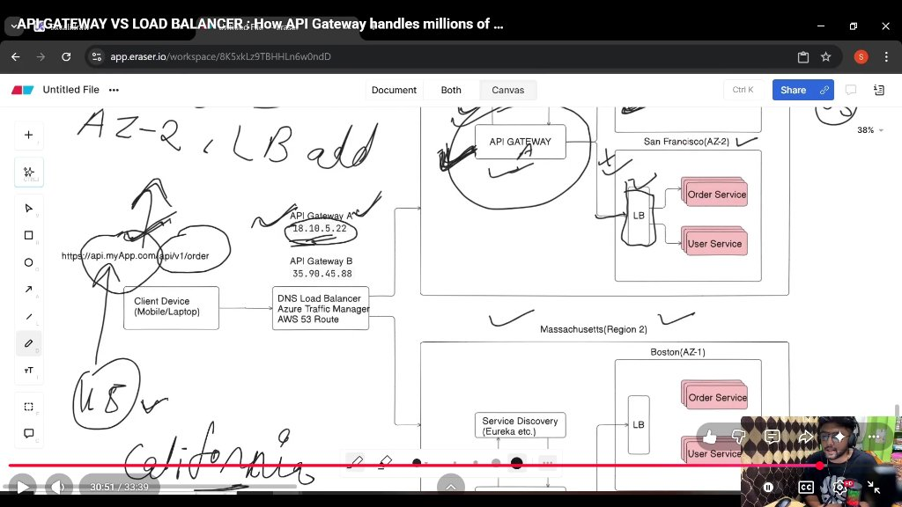

# Topic 03: API Gateway, Load Balancer & DNS Load Balancing (Handling Millions of Requests)

> **Lecture Context:** Deconstructing the Architecture Canvas from YouTube: Client ➔ DNS Route 53 ➔ Regional Gateways ➔ Service Discovery ➔ Load Balancers ➔ Microservices.

---

## 1. What is a Load Balancer (LB)?

A **Load Balancer** sits between client devices and backend server instances. Its core duty is to distribute incoming traffic evenly across healthy backend nodes, preventing bottlenecks and handling server crashes automatically.

### Layer 4 vs Layer 7 Load Balancers

```
  Layer 4 (Transport: TCP / UDP)           Layer 7 (Application: HTTP / HTTPS)
  ──────────────────────────────           ──────────────────────────────────
  • Sees only IP:Port                      • Inspects Headers, Cookies, URL paths
  • Packet-level forwarding                • Content-based intelligent routing
  • Blazing fast (kernel/hardware)         • Slightly higher CPU overhead
  • Example: AWS NLB, HAProxy TCP          • Example: AWS ALB, NGINX
```

### Standard Load Balancing Algorithms:
1. **Round Robin:** Passes each new request sequentially to the next server in the list.
2. **Weighted Round Robin:** Sends more traffic to higher-spec servers based on assigned weight.
3. **Least Connections:** Forwards traffic to the server currently handling the fewest active connections (ideal for long-lived WebSocket sessions).
4. **IP Hash:** Hashes the client's IP address to route the same client consistently to the same server (session persistence / sticky sessions).

---

## 2. What is an API Gateway?

An **API Gateway** is an intelligent reverse proxy that acts as the single orchestrator and perimeter entry door for all client devices (Web, iOS, Android, 3rd party developers) into your microservices ecosystem.

### Why not let clients call microservices directly?
- **Network Handshake Multiplier:** To render one mobile dashboard, the phone would have to open 10 separate TLS handshakes over flaky cellular networks.
- **Security Attack Surface:** Exposing 50 internal microservices directly to the public internet means 50 endpoints must manage certificates, CORS, and vulnerability patches.
- **Client-Service Tight Coupling:** If an internal microservice URL or data contract changes, all mobile apps worldwide break until users download an app update.

---

## 3. The 6 Superpowers of an API Gateway

1. **Authentication & Authorization:**  
   Decodes and validates JWT tokens or OAuth2 API keys once at the edge. Downstream microservices don't need to duplicate auth logic—they receive pre-authenticated headers (e.g. `X-User-Id: 4091`).
2. **SSL/TLS Termination:**  
   Handles expensive cryptographic decryption at the edge; internal microservices within the private Virtual Private Cloud (VPC) communicate over fast, plain HTTP/2 or gRPC.
3. **Rate Limiting & Throttling:**  
   Protects backend servers against DDoS attacks, runaway scrapers, and spam using algorithms like **Token Bucket** or **Leaky Bucket** backed by Redis.
4. **Dynamic Request Routing:**  
   Directs `/api/v1/order` to the Order Service cluster and `/api/v1/user` to the User Service cluster.
5. **Request Aggregation (BFF - Backend For Frontend):**  
   A mobile screen might need user details, active orders, and notifications. The Gateway queries all three services concurrently and returns one consolidated JSON response.
6. **Protocol Translation:**  
   Converts incoming public REST/JSON over HTTP/1.1 into high-performance internal gRPC/Protobuf.

---

## 4. API Gateway vs Load Balancer: Why We Need Both

| Dimension | Load Balancer (e.g. AWS ALB, NGINX) | API Gateway (e.g. Kong, Apigee, Spring Cloud Gateway) |
| :--- | :--- | :--- |
| **Primary Goal** | Balance network traffic across identical server replicas | Single entry point, edge security, routing, aggregation |
| **OSI Layer** | Layer 4 (TCP/UDP) or Layer 7 (HTTP) | Strictly Layer 7 (Application Logic aware) |
| **Authentication** | Usually passes headers transparently | Deep: JWT verification, OAuth2, RBAC roles |
| **Rate Limiting** | Connection/IP level | Per-user, per-API-key, per-subscription tier |
| **Payload Mutation**| No (passes raw stream) | Yes (aggregates, rewrites URLs, transforms formats) |

> **Summary:** A Load Balancer is a high-speed traffic cop; an API Gateway is a smart receptionist and security guard. In high-scale systems, **they work together!**

---

## 5. DNS Load Balancing (AWS Route 53 / Azure Traffic Manager)

Before a client request even touches your data center, it must resolve the domain `api.myApp.com` to an IP address.

### How DNS Load Balancing Works:
Traditional DNS servers return a static IP address. Intelligent DNS Load Balancers (like **AWS Route 53** or **Azure Traffic Manager**) inspect the caller's geographic location and current data center health:

1. **Geo-Location Routing:** Returns the IP of the California data center (`18.10.5.22`) for US-West users and the Boston data center (`35.90.45.88`) for US-East users.
2. **Latency-Based Routing:** Continuously monitors round-trip times from global network probes and directs the user to the lowest-latency AWS region.
3. **Health Check Failover:** If an entire region goes down, DNS automatically stops returning that region's IP and redirects all global traffic to the backup region within seconds!

---

## 6. How the System Handles Millions of Requests (Video Canvas Walkthrough)



Here is the exact request lifecycle matching the YouTube video diagram:

```
[ Client Device (Mobile/Laptop) ]
               │
               ▼  1. Resolves: api.myApp.com
┌──────────────────────────────────────────────┐
│  DNS Load Balancer (AWS Route 53 / Azure TM) │
└──────────────────────────────────────────────┘
       │                                │
       │ (User in California)           │ (User in Massachusetts)
       ▼                                ▼
┌──────────────────────────────┐  ┌──────────────────────────────┐
│ Region 1: San Francisco AZ-2 │  │ Region 2: Massachusetts AZ-1 │
│ ──────────────────────────── │  │ ──────────────────────────── │
│ • API Gateway A (18.10.5.22) │  │ • API Gateway B (35.90.45.88)│
│ • SSL Term + JWT + Throttling│  │ • Service Discovery (Eureka) │
│ • Internal Load Balancer     │  │ • Internal Load Balancer     │
│   ├─ Order Service (Replicas)│  │   ├─ Order Service (Replicas)│
│   └─ User Service (Replicas) │  │   └─ User Service (Replicas) │
└──────────────────────────────┘  └──────────────────────────────┘
```

### The 6-Step Journey:
1. **Client Request:** The user hits checkout: `GET https://api.myApp.com/api/v1/order`.
2. **DNS Resolution:** AWS Route 53 checks client IP (California), selects the San Francisco region, and returns `18.10.5.22`.
3. **Regional API Gateway A:**
   - Decrypts HTTPS (SSL Termination).
   - Validates client JWT token.
   - Checks Redis Token Bucket rate limit quota.
   - Inspects URL path prefix `/api/v1/order`.
4. **Service Discovery (Netflix Eureka / Consul):**
   - Microservice pods dynamically scale up, down, or restart with ephemeral IP addresses.
   - Service Discovery maintains the active registry of healthy `Order Service` IP addresses.
5. **Internal Load Balancer (AZ-2):**
   - Receives traffic from the Gateway and distributes it across the healthy `Order Service` pod replicas using Round Robin.
6. **Execution & Response:**
   - The Order Service completes the query and sends a `200 OK` response back through the internal LB and API Gateway to the user's mobile screen in ~35ms.
